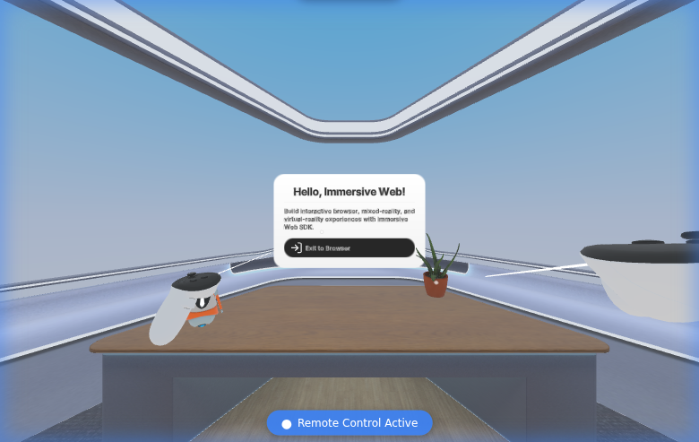

# Orbit Cut

A 360° video cut-direction editor: align the subject across a cut while watching in an immersive headset, then export the corrected video.

**Prototype stage.** The low-resolution offline rotation proof passes. The XR bootstrap currently preserves the official IWSDK starter scene. The hosted runtime gate passes: a rendered application, active emulated XR, and controller grab → move → release measured at 0.559 m. The editing workflow is the next milestone.

## Runtime foundation

[Passing run](https://github.com/blucca/orbit-cut/actions/runs/38944870438) · [Measured receipt](docs/runtime-proof.json)



The first hosted attempt reached the command bridge before the application offered XR. Waiting for the application’s session offer fixed that readiness race; the unchanged scene and production build then passed.

## Run the runtime gate

```sh
npm ci
npx playwright install --with-deps chromium
npm run typecheck
IWSDK_GPU=swiftshader python3 scripts/xr-smoke.py
npm run build
```

The GitHub Actions workflow runs this on a standard Linux runner and retains its JSON receipts, runtime image, and logs. It uses a separate browser with no account or credential data. Software-emulated XR checks interaction logic; Quest performance is a separate measurement.

[IWSDK testing guide](https://iwsdk.dev/guides/02-testing-experience.html) · [IWER browser emulator](https://meta-quest.github.io/immersive-web-emulation-runtime)

The starter code and stock scene are from Meta’s MIT-licensed IWSDK. Orbit Cut’s editing loop is the next implementation milestone after the runtime gate.
