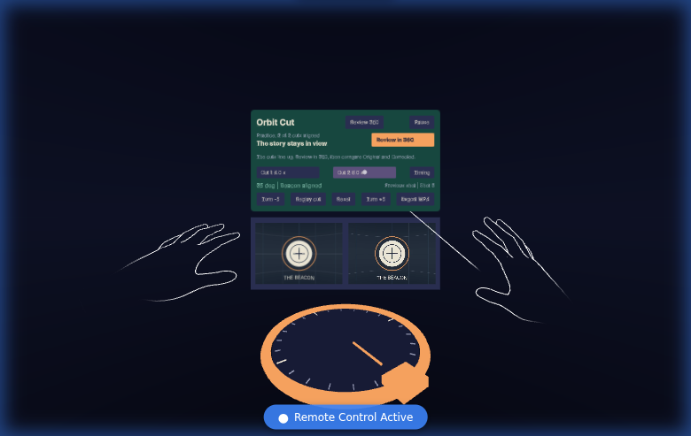
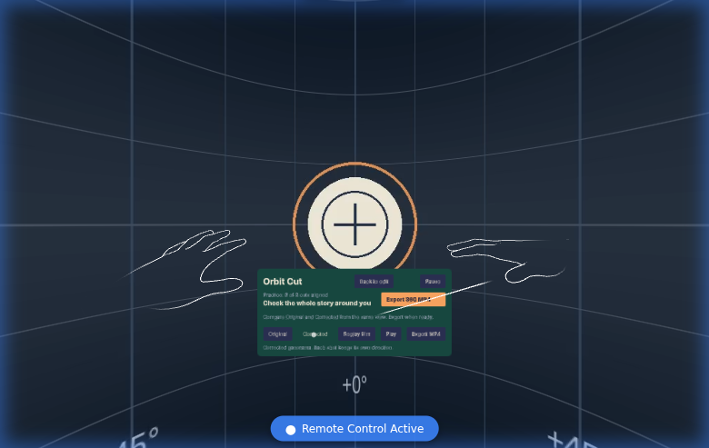

# Orbit Cut

Keep the subject in view when a 360° film cuts to its next shot.

Two matching lenses show the corrected previous shot and the video after a cut. Pinch the orange wheel to rotate the next shot, review the whole film as a panorama, and export the changed pixels as an MP4.

**A seated, two-cut workbench.** Follow the orange next-step button through alignment, panoramic review and export. The built-in twelve-second synthetic exercise shows your progress across cuts at 4 and 8 seconds, with source headings of 0°, +55°, and -35°. Open a local monoscopic 2:1 MP4 to work on your own footage, or try **Waterfall practice** for an attributed real-camera clip with an intentionally added cut. Video files are processed in the browser. [Media sources and modifications](public/media/SOURCES.md).

[Open the workbench](https://blucca.github.io/orbit-cut/) · [Guided task and pause/resume receipt](docs/guided-task-proof.json) · [Real-camera export measurements](docs/real-media-proof.json) · [360 export recognition](docs/spherical-export-proof.json)

Have a Quest and eight minutes? [Try the editing task and tell us where it gets awkward.](docs/quest-playtest.md)



## Editing

- Point and pinch the wheel, then turn your hand. Controllers also work; the turn buttons offer 5° steps.
- Select **Cut 1** or **Cut 2** in the headset. Open **Timing** to move its boundary in 0.1- or 1-second steps; **Add cut** creates a second boundary and inherits the preceding shot's direction.
- The left lens includes the preceding shot's correction. Editing Cut 2 keeps Cut 1 intact.
- **Replay cut** starts two seconds before the cut. The left lens remains your reference.
- **Review 360** surrounds you with the film. **Original** and **Corrected** share the same viewing direction; pause to compare a fixed frame, or replay the whole film. **Back to edit** returns to the selected cut.
- **Reset** removes only the selected shot's rotation. **Export MP4** renders all corrected shots in real time, with the soundtrack.
- The save link stays available in the browser after leaving immersion.
- **Pause**, leaving immersion, or switching away from the tab pauses work. **Continue** keeps the current film, cuts, selection and corrections; playback waits for you to press **Play**. Keep this tab open to retain the session.
- Pausing an export stops it safely. Continue and choose **Export again** to make a complete MP4 from the retained edits.



Review export uses the browser's native recorder, up to 30 fps. It prefers H.264/AAC when available; Chromium's tested fallback is an MP4 containing VP9/Opus. The exact format is shown after export. Exports carry explicit monoscopic equirectangular 360° metadata (Spatial Media v1). FFmpeg and MediaInfo recognize the projection, while native-browser checks retain playback, sound and seeks. The tagging step preserves encoded packets and timestamps. Frame-exact delivery and physical Quest performance remain quality milestones.

## Run and verify

```sh
npm ci
npx playwright install --with-deps chromium
npm run typecheck
IWSDK_GPU=swiftshader python3 scripts/xr-smoke.py
ORBIT_MEDIA_OUTPUT="$PWD/temp/media" node scripts/media-smoke.mjs
npm run build
```

The media check needs FFmpeg. It imports two synthetic videos, rotates actual decoded frames, exports and reopens the MP4, measures the changed pixels, checks the soundtrack, and verifies spherical metadata and unchanged packet payloads/timestamps for the tagging step. The XR check uses the SDK's controller and hand inputs rather than changing application state directly. GitHub Actions retains the resulting receipts and images, and publishes successful builds to Pages.

XR is an immersive session. [IWSDK's testing guide](https://iwsdk.dev/guides/02-testing-experience.html) describes it; [IWER](https://meta-quest.github.io/immersive-web-emulation-runtime) provides the browser emulator used by the checks. A controller's target ray points at controls; its grip pose is where an object is held. [IWSDK's interaction guide](https://iwsdk.dev/concepts/interaction/grabbing.html) covers those input paths. The app's entity-component system (ECS) keeps editing state inspectable through named components; see [IWSDK concepts](https://iwsdk.dev/concepts/).

[Earlier runtime foundation receipt](docs/runtime-proof.json) records the separate, unchanged starter-scene gate. Emulated interaction and physical headset measurements are tracked separately.

Built with Meta's MIT-licensed Immersive Web SDK.
