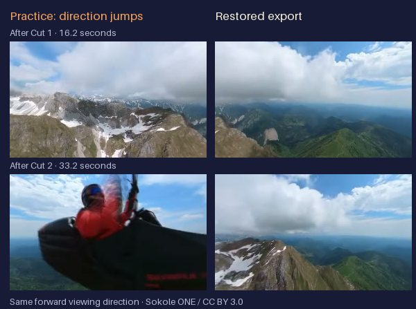

# Keep the ridge in view

A fifty-second flight. Two direction jumps. Bring the landscape back into line.

This exercise uses a continuous 1920×960 paragliding camera recording by **Sokole ONE**. We deliberately turned the picture at 16 and 33 seconds. Use Orbit Cut to restore its original direction, then save the result with sound.

**[Download the practice MP4 · 23 MB](https://github.com/blucca/orbit-cut/releases/download/camera-review-20261018/tolmin-flight-practice.mp4)**

[Open Orbit Cut](https://blucca.github.io/orbit-cut/) · [Download the completed native export](https://github.com/blucca/orbit-cut/releases/download/camera-review-20261018/tolmin-flight-restored-native.mp4) · [Measurements](camera-review-proof.json)

## Try the edit

1. Download the practice file, open Orbit Cut, and choose **Open 360 video**. Select the downloaded MP4. On Quest, enter the immersive workbench after loading it.
2. Open **Timing** and place **Cut 1 at 16.0 seconds**. Pinch and turn the wheel until the landscape lines up between the reference views. The correction is **−90°**; release and regrip as needed, or use the 5° turn buttons.
3. Choose **Add cut**, place **Cut 2 at 33.0 seconds**, and set its correction to **+90°**. This is the second segment's absolute correction; the first cut stays at −90°.
4. Choose **Review in 360**. Compare **Original** and **Corrected** from the same direction. Replay each cut: the introduced quarter-turns disappear.
5. Choose **Export 360 MP4**, keeping the tab visible. Allow about the clip's fifty-second length. Leave immersion, save the result, choose **Continue editing**, and reopen your saved file with **Open 360 video**.

The downloaded completed export lets you review the result before doing the exercise. Files you open are processed in your browser.

## What the published sample establishes

The media check loads the practice file through a native file input, uses Orbit Cut's production `MediaSession` to apply both corrections, downloads the real native export, and opens that download through a new file input/session. It then seeks around both cuts and plays to the natural end. The [receipt](camera-review-proof.json) includes the dimensions, output format, timings, pixel comparisons, sound and independent 360° metadata recognition.

The published export took **51.4 seconds** for the 50.54-second input; its saved duration is **50.48 seconds**. Audio waveform delay stayed at **10.19 milliseconds** across the three sampled audible windows. The video contains 1,132 frames against 1,244 in the source, with a largest recorded frame gap of 111 milliseconds.

These measurements cover Linux/Chromium 154's native media path. [Emulated hand interaction](guided-task-proof.json) and the [eight-minute physical Quest trial](quest-playtest.md) cover their respective interaction tasks. Review recording uses variable frame timing; preserve your original camera file for later frame-exact finishing.

## Footage and attribution

“[2021 06 12 PARA 360 Tolmin SokoleONE 2 - UP Kangri](https://commons.wikimedia.org/wiki/File:2021_06_12_PARA_360_Tolmin_SokoleONE_2_-_UP_Kangri.webm)” by **Sokole ONE**, [CC BY 3.0](https://creativecommons.org/licenses/by/3.0/), via Wikimedia Commons. Orbit Cut transcoded the film, introduced the two practice direction jumps, and made the corrected review export. The original soundtrack includes quiet sections and continues briefly after the last camera frame.

Retain this attribution when sharing your export. [Full source and modification notes](../public/media/SOURCES.md).
